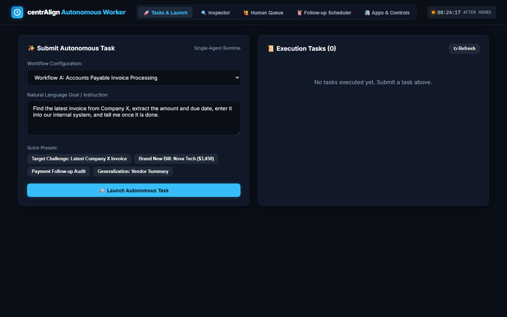
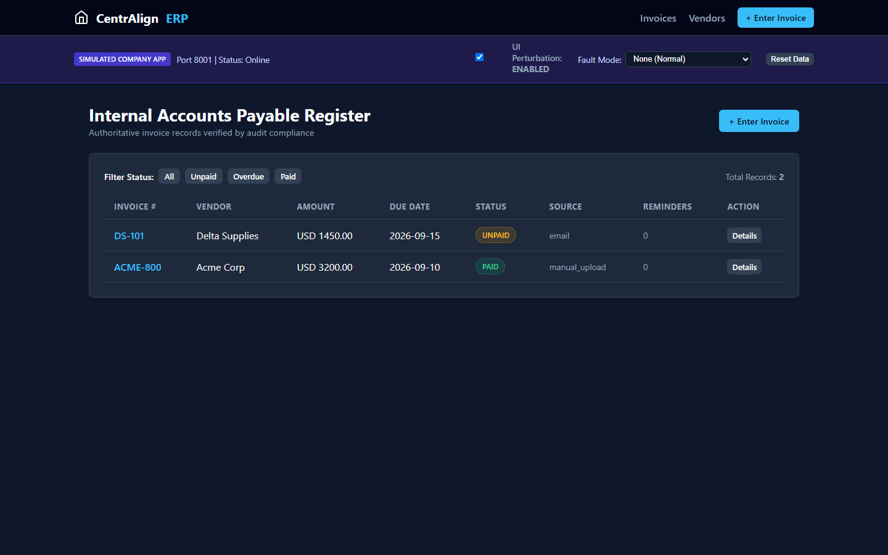
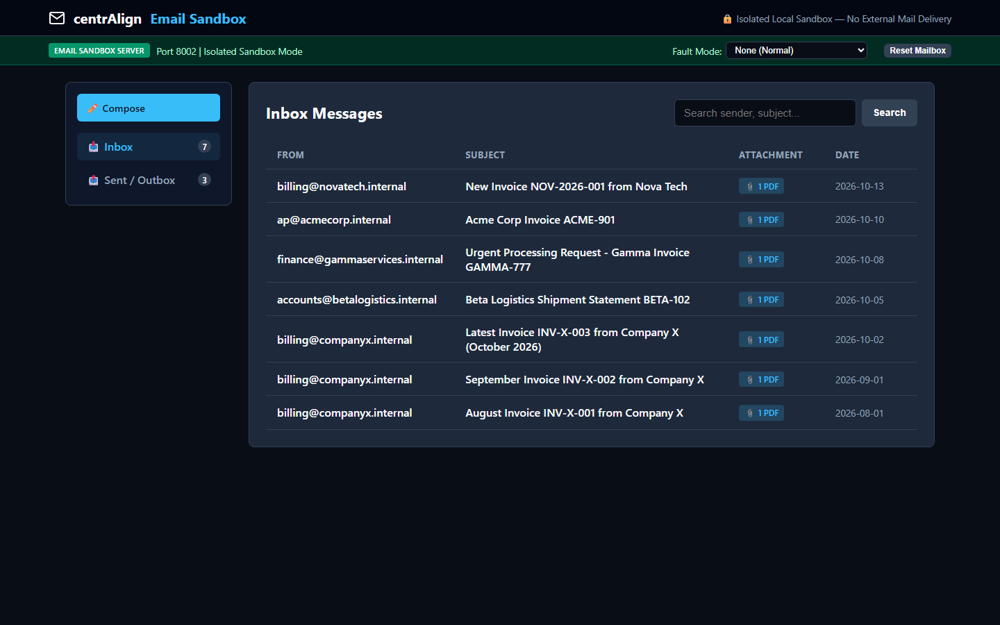
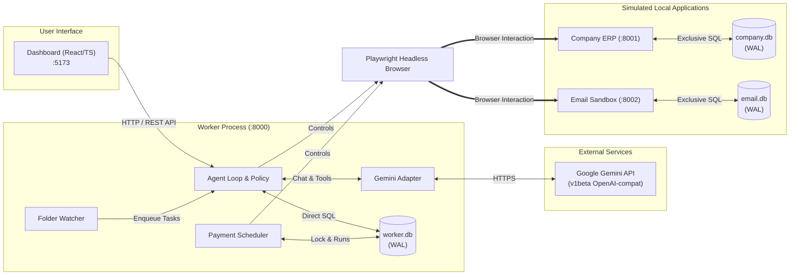
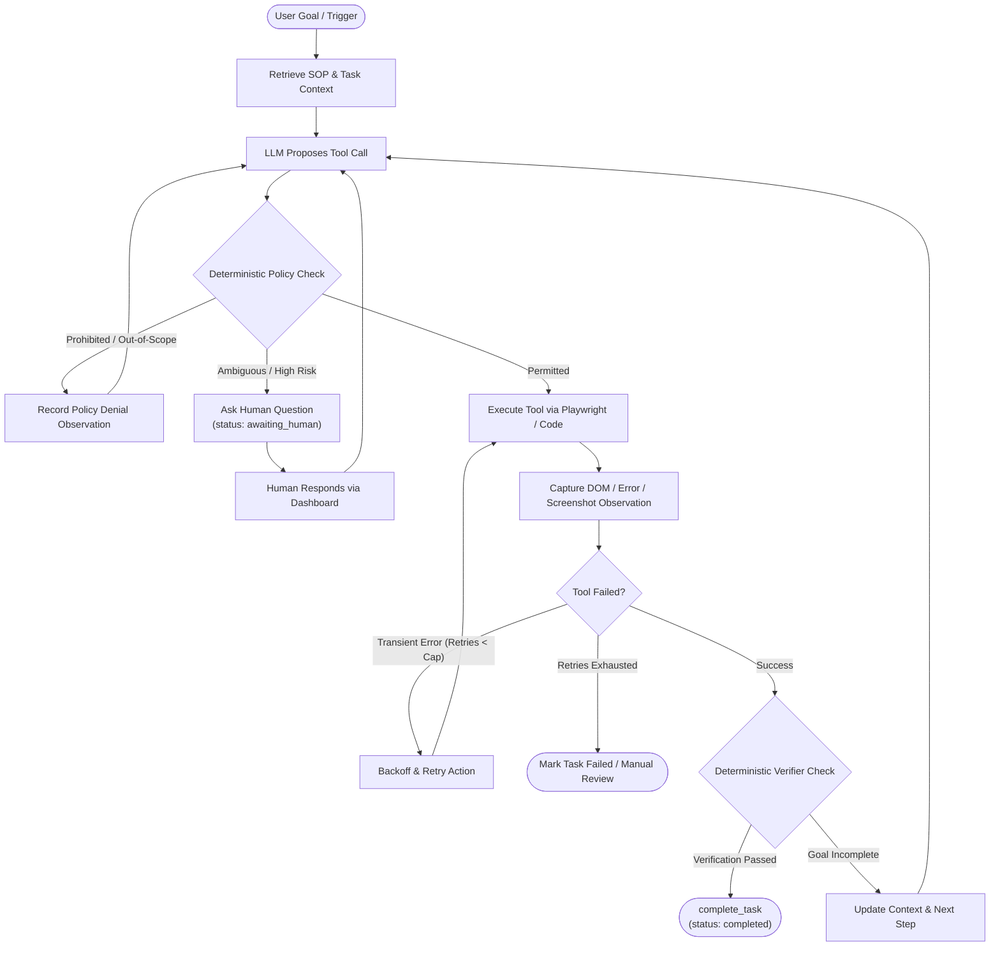
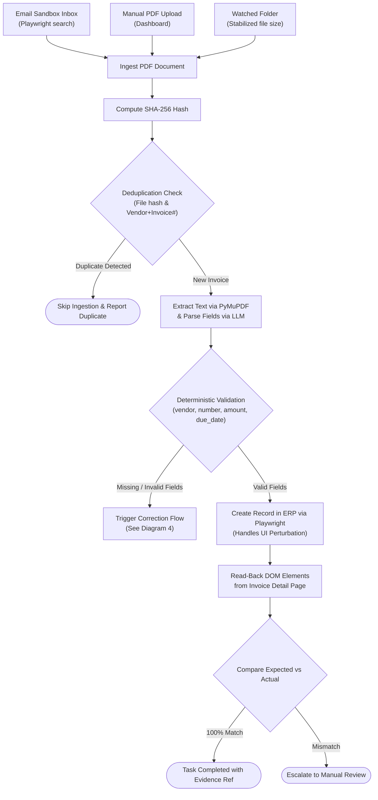
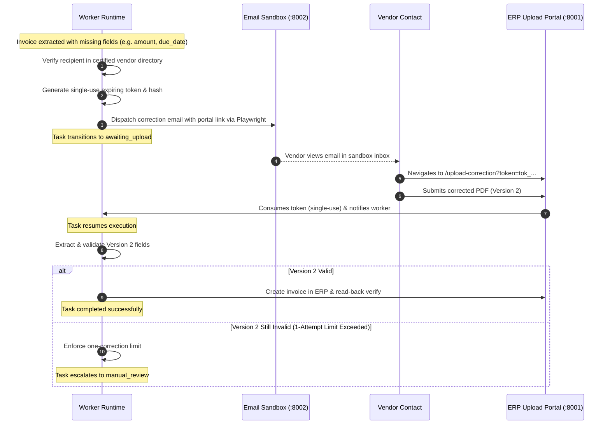
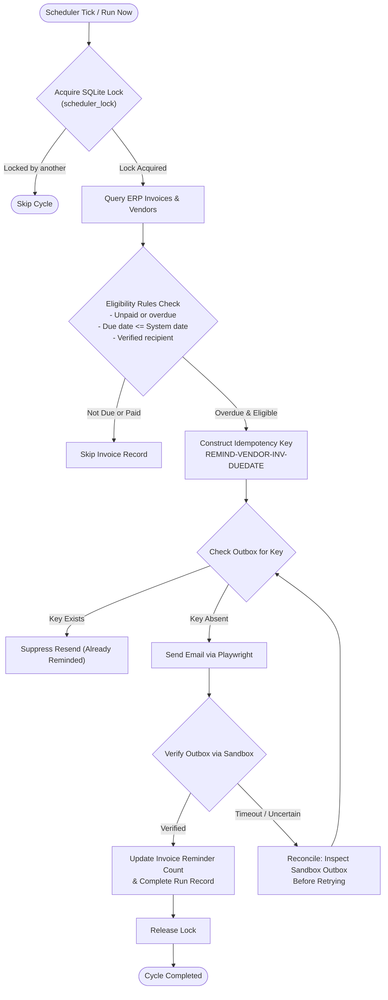
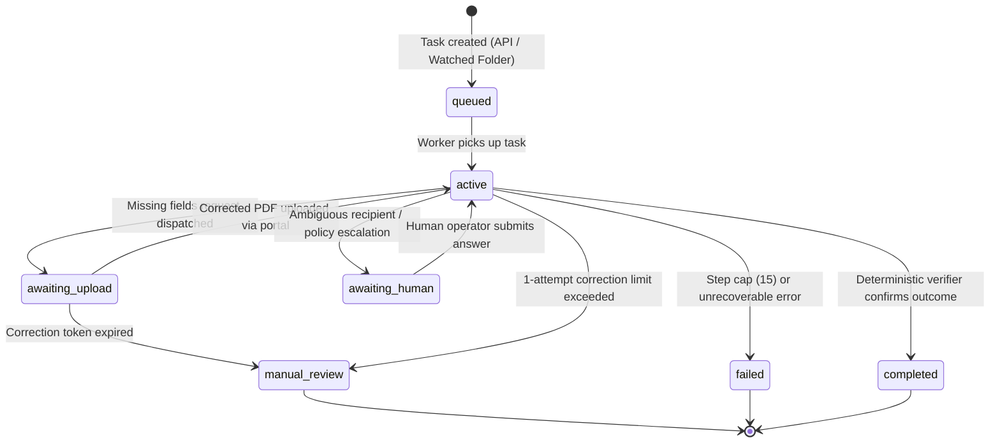

# Autonomous AI Task Worker

A locally runnable autonomous AI task worker prototype built for the **CentrAlign AI Engineering Intern Challenge**. The worker accepts natural language goals, navigates simulated local web applications using Playwright, extracts and validates document contents, observes outcomes, recovers safely from faults, escalates ambiguous decisions to human operators, and verifies completion through independent deterministic checks.

- **Multi-Source Ingestion:** Ingests invoices by browsing an email sandbox inbox, processing manual PDF uploads, or monitoring a watched directory (`data/watched/`) with file stabilization detection.
- **Independent Verification:** Creates accounting records in a local ERP application through browser automation, verifying completion via deterministic DOM read-back comparisons rather than relying on model self-assertions.
- **Safe Recovery & Correction:** Dispatches single-use expiring token links (`/upload-correction`) to certified vendor emails for missing fields, enforcing a strict one-correction limit before escalating to manual review.
- **Scheduled Payment Follow-Up:** Audits overdue invoices and dispatches payment reminders under business-hours constraints (`Asia/Kolkata`), preventing duplicate delivery through deterministic outbox idempotency keys.
- **UI Adaptation & Resilience:** Adapts dynamically to UI perturbation (reordered fields, altered selectors, mandatory confirmation checkboxes) and safely reconciles state after simulated timeouts.

---

## Table of Contents

1. [System Interface & Application Previews](#1-system-interface--application-previews)
2. [Key Ideas and Design Principles](#2-key-ideas-and-design-principles)
3. [Architecture at a Glance](#3-architecture-at-a-glance)
4. [How the Agent Works](#4-how-the-agent-works)
5. [Implemented Workflows](#5-implemented-workflows)
   - [Workflow A: Invoice Processing](#workflow-a-invoice-processing)
   - [Missing Fields and Correction Flow](#missing-fields-and-correction-flow)
   - [Workflow B: Scheduled Payment Follow-Up](#workflow-b-scheduled-payment-follow-up)
   - [Workflow C: Generalization Demonstration](#workflow-c-generalization-demonstration)
6. [Reliability and Safety](#6-reliability-and-safety)
7. [Quick Start](#7-quick-start)
   - [Prerequisites](#prerequisites)
   - [Installation & Setup](#installation--setup)
   - [Services & Health Checks](#services--health-checks)
   - [5-Minute Demo Walkthrough](#5-minute-demo-walkthrough)
8. [Configuration](#8-configuration)
9. [Project Structure](#9-project-structure)
10. [Technical Decisions and Trade-offs](#10-technical-decisions-and-trade-offs)
11. [Dependencies and External Services](#11-dependencies-and-external-services)
12. [Testing and Verification](#12-testing-and-verification)
13. [Assumptions](#13-assumptions)
14. [Known Limitations](#14-known-limitations)
15. [What I Would Build Next](#15-what-i-would-build-next)
16. [AI-Assisted Development Note](#16-ai-assisted-development-note)
17. [Troubleshooting](#17-troubleshooting)

---

## 1. System Interface & Application Previews

The platform operates across four isolated local services: the operational worker dashboard, the simulated company ERP, the simulated email sandbox, and the worker runtime API. Below are actual screenshots of the primary application interfaces:

### Operational Dashboard (`http://localhost:5173`)

*Figure 1: CentrAlign Autonomous Worker Dashboard — mission control panel featuring natural-language task submission, quick-presets, live execution inspector, human question queue, and follow-up scheduler controls.*

### Company ERP Application (`http://localhost:8001`)

*Figure 2: Internal Accounts Payable Register — simulated enterprise accounting ledger displaying vendor directory, invoice status filters, and developer controls (UI Perturbation toggle and Fault Mode selector).*

### Email Sandbox Application (`http://localhost:8002`)

*Figure 3: Simulated Email Sandbox — local isolated mailbox seeded with multi-vendor invoice emails (Company X, Nova Tech, Acme Corp, Beta Logistics) with PDF attachments and outbox idempotency verification.*

---

## 2. Key Ideas and Design Principles

- **Single Workflow-Agnostic Runtime:** Workflows are configuration (SOP document + permitted tool allowlist + verifier requirements + success criteria), not hardcoded code pipelines. Adding a new task changes configuration, not the runtime engine.
- **Model Proposes, Code Disposes:** Gemini selects the next logical action dynamically, but deterministic application code owns policy enforcement, tool execution, argument validation, and terminal transitions.
- **Independent Deterministic Verification:** The model is never permitted to self-certify completion. An invoice task is marked complete only after an independent UI DOM read-back comparison confirms all fields match the original source.
- **Idempotent Side Effects & Safe Reconciliation:** Deterministic idempotency keys and pre-action intent records prevent duplicate ERP records or repeated reminder emails, even across network timeouts and process crashes.
- **Risk-Based Autonomy with Human-in-the-Loop:** Routine, policy-cleared actions proceed automatically; ambiguous recipients, conflicting financial values, and exhausted retries pause into a persistent queue for human review.

---

## 3. Architecture at a Glance



The system separates user interaction, task execution, and business domain state across four isolated local services. The React operational dashboard and background directory watchers dispatch task goals to the worker runtime API. 

The worker interacts with the Company ERP and Email Sandbox exclusively through user-facing browser sessions using Playwright, strictly avoiding direct database mutations on those applications. Each service maintains exclusive ownership over its own SQLite database in WAL mode to guarantee isolation, while external intelligence is supplied by Google's Gemini API through an OpenAI-compatible adapter.

---

## 4. How the Agent Works



The worker executes a bounded control loop (capped at 15 steps per task) designed around goal-driven action and observation. In each cycle, the authoritative business SOP and action history are provided to Gemini to propose the single best tool call. 

Before execution, a deterministic code-owned policy engine verifies tool permissions and risk level against the workflow allowlist. The tool is then executed via Playwright or Python domain handlers, observations and screenshot references are recorded in the state store, and deterministic verifiers confirm whether the goal has been independently verified.

### Deterministic Code vs. Model-Driven Decisions

| Decision Area | Owner | Implementation & Rationale |
|---|---|---|
| **Next Tool Proposal** | LLM (Gemini 2.5 Flash) | Analyzes dynamic page states, natural language goals, and document extracts to select appropriate next steps. |
| **Tool Permissions & Allowlist** | Deterministic Code | Enforces workflow-scoped allowlists; document contents and page text cannot grant permissions or invoke unlisted tools. |
| **Financial Safeguards** | Deterministic Code | Payment initiation and financial transaction approvals are strictly prohibited by code policy; autonomous reminders and record logging only. |
| **Validation & Deduplication** | Deterministic Code | PyMuPDF text validation, SHA-256 content hashes, and normalized `(vendor, invoice_number)` checks ensure zero phantom records. |
| **Completion Verification** | Deterministic Code | Model claims of success are discarded; task completion requires 100% field-matching DOM read-back verification. |
| **Retry & Reconciliation** | Deterministic Code | Exponential backoff limits, outbox idempotency keys, and pre-action intent logging prevent duplicate side effects after timeouts. |
| **Human Escalation** | Deterministic Code | Unverified email recipients, conflicting financial values, and exhausted retries immediately pause execution into `awaiting_human`. |

---

## 5. Implemented Workflows

### Workflow A: Invoice Processing



The invoice processing workflow normalizes input across three entry vectors: browsing the simulated email inbox, manual user upload, or automated folder watching. Each PDF is hashed with SHA-256 and checked against the ERP database to reject existing duplicates. 

After PyMuPDF extracts text, deterministic validation verifies required fields (`vendor`, `invoice_number`, `amount`, `due_date`). Valid invoices are entered into the ERP via Playwright, adapting dynamically if form fields are perturbed, and verified against the rendered record view.

### Missing Fields and Correction Flow



When an invoice lacks required fields, the system identifies the vendor's certified contact from the internal ERP directory. If no verified contact exists, the task pauses into `awaiting_human` rather than sending to an arbitrary address. 

When verified, the worker issues an unguessable single-use token (valid for 48 hours), stores its SHA-256 hash in `worker.db`, and dispatches an email to the sandbox outbox containing a link to `/upload-correction?token=...`. 

When the vendor uploads Version 2, the token is consumed, and the task resumes. If the replacement PDF remains invalid, the strict **one-correction limit** triggers an escalation to `manual_review`.

### Workflow B: Scheduled Payment Follow-Up



The payment follow-up scheduler runs in the background of the worker process, guarded by a single-instance lock row in `worker.db`. During each cycle, it queries ERP invoices and cross-references certified vendor contacts. Invoices marked `paid` or whose due dates are in the future are skipped. 

For each overdue unpaid invoice, the system constructs a deterministic idempotency key (`REMIND-{VENDOR}-{INV}-{DUEDATE}`) and checks the email sandbox outbox before sending. If the key already exists, resending is suppressed. Reminders are dispatched via Playwright, verified in the outbox, and the invoice reminder count is updated in the ERP.

### Workflow C: Generalization Demonstration

To demonstrate that the runtime is truly workflow-agnostic, a third task (**Vendor Summary Audit Report**) was implemented without modifying any core runtime, agent loop, or policy infrastructure.

**Goal:** *"Audit all invoices for Acme Corp and report total payments and outstanding balance."*

**Exact Files Added / Changed:**
1. `knowledge/sops/vendor_summary_report.md` *(New)*: Authoritative business SOP defining report objectives, directory lookup procedures, and output formats.
2. `workflows/workflow_config.py` *(Registered)*: Added `vendor_summary_report` configuration with allowed tools `["lookup_vendor", "audit_vendor_invoices", "browser_navigate", "browser_get_page_snapshot", "complete_task"]`.
3. `services/worker/generalization_flow.py` *(New)*: Domain tool handlers `lookup_vendor` and `audit_vendor_invoices`.

**Core Engine Files Left Completely Unchanged:**
- `services/worker/agent_loop.py`
- `services/worker/policy.py`
- `services/worker/state_store.py`
- `services/worker/llm_adapter.py`
- `packages/browser-tools/primitives.py`

---

## 6. Reliability and Safety



The system employs seven concrete reliability and safety mechanisms:

1. **Bounded Retries with Exponential Backoff:** Network glitches and transient HTTP 500 errors are retried up to 3 times with exponential backoff (1s, 2s, 4s). A hard cap of 15 steps per task prevents run-away loops.
2. **Deterministic Idempotency Keys:** Every outbound email carries a unique key (`REMIND-{VENDOR}-{INV}-{DUEDATE}` or `REQ-CORRECT-{INV}`). Outbox checks prevent duplicate transmissions.
3. **Pre-Action Intent Records:** State transitions and tool parameters are logged in `worker.db` before browser side effects execute.
4. **Reconciliation After Timeouts:** When a browser interaction times out (e.g. HTTP 504), the worker does not blindly retry. It queries the target system to determine if the record was committed prior to timeout.
5. **Restart Recovery:** All tasks, steps, token hashes, and scheduler runs reside in SQLite (WAL mode). On process restart, active tasks resume from their last recorded step.
6. **Upload-Link Safeguards:** Correction portal tokens are 48-byte cryptographically secure strings stored solely as SHA-256 hashes, scoped to a single invoice, single-use, and expire in 48 hours.
7. **Prompt-Injection Defense:** Extracted document text and web page accessibility trees are treated as untrusted strings. Policy allowlists and prohibited actions (`execute_shell`, `initiate_payment`) are enforced strictly by deterministic Python logic.

---

## 7. Quick Start

### Prerequisites
- **Operating System:** Windows 10/11 (targeted & verified), macOS, or Linux.
- **Python:** Python 3.11+ (verified on Python 3.14.7).
- **Node.js:** Node.js 18+ (verified on Node v24.21.0). The dashboard can run via the included Python runner or standard Vite.
- **Browser Automation:** Playwright Chromium engine.

### Installation & Setup

1. **Clone and enter repository:**
   ```bash
   cd c:\Users\bhavyansh\Code\centrAlign\antigravtiy
   ```

2. **Create and activate virtual environment:**
   ```powershell
   # Windows PowerShell:
   python -m venv .venv
   .\.venv\Scripts\Activate.ps1

   # Linux / macOS:
   python3 -m venv .venv
   source .venv/bin/activate
   ```

3. **Install dependencies and Playwright Chromium:**
   ```bash
   pip install -r requirements.txt
   playwright install chromium
   ```

4. **Configure environment:**
   ```powershell
   # Windows PowerShell:
   copy .env.example .env

   # Linux / macOS:
   cp .env.example .env
   ```
   Add your Gemini API key to `.env` (`GEMINI_API_KEY=AIzaSy...`).

### Services & Health Checks

Start all four micro-services using the orchestrator:

```bash
python scripts/start_all.py
```
*(Alternative on Windows PowerShell: `.\scripts\start_all.ps1`)*

The startup orchestrator seeds all databases and checks endpoint health:

| Service | Port | Local URL | Health Check URL | Description |
|---|---|---|---|---|
| **Operational Dashboard** | `5173` | [http://localhost:5173](http://localhost:5173) | `http://localhost:5173/index.html` | React / TS operator interface and task launcher |
| **Company ERP App** | `8001` | [http://localhost:8001](http://localhost:8001) | `http://localhost:8001/health` | Invoice ledger, vendor directory, Dev Bar |
| **Email Sandbox App** | `8002` | [http://localhost:8002](http://localhost:8002) | `http://localhost:8002/health` | Seeded inbox, sandbox outbox, PDF attachments |
| **Worker API & Runtime** | `8000` | [http://localhost:8000/docs](http://localhost:8000/docs) | `http://localhost:8000/health` | Agent runtime, state store, OpenAPI docs |

To stop all background services cleanly:
```bash
python scripts/stop_all.py
```
*(Alternative on Windows PowerShell: `.\scripts\stop_all.ps1`)*

---

### 5-Minute Demo Walkthrough

A reviewer can execute this sequence to inspect all core capabilities:

#### Step 1: Natural Language Task — "Find latest invoice from Company X"
1. Open the **Dashboard** at `http://localhost:5173`.
2. Under **New Task Mission**, select **Workflow A (Invoice Processing)**.
3. Paste: *"Find the latest invoice from Company X, extract the amount and due date, enter it into our internal system, and tell me once it is done."*
4. Click **Launch Autonomous Task**.
5. Switch to the **Execution Inspector** tab:
   - Observe the agent search the sandbox for "Company X", identify three invoices (August, September, October), and select `EML-X-03` (October 2026).
   - Observe the download of `invoice_company_x_2026_10_latest.pdf` and extraction: Amount `$2,100.00`, Due Date `2026-10-31`.
   - Observe Playwright navigate to `http://localhost:8001/invoices/new` and submit the entry.
   - Verify the deterministic verifier executes read-back comparison on `http://localhost:8001/invoices/{id}` and completes with status `completed`.

#### Step 2: Watched Folder Ingestion
1. Copy `data/synthetic_pdfs/invoice_acme_valid.pdf` into `data/watched/`.
2. Watch the terminal logs: `FolderWatcher` monitors the file, confirms its byte size remains stable for 2 seconds, and enqueues task execution.
3. Check the Dashboard: the invoice is extracted and created automatically.

#### Step 3: UI Perturbation Adaptation
1. Open **Company ERP** at `http://localhost:8001`.
2. In the top Dev Bar, toggle **UI Perturbation: ENABLED**.
3. Inspect `http://localhost:8001/invoices/new`: Input order is changed, the invoice field is labeled "Reference / Doc #", and an accuracy confirmation checkbox is required.
4. Launch an invoice creation task from the Dashboard.
5. In the Execution Inspector, observe the agent inspect the dynamic DOM accessibility tree, discover the perturbed fields, check `#confirm-accuracy`, click `#btn-submit-entry`, and achieve verified completion.

#### Step 4: Injected Fault & Safe Reconciliation
1. In the Company ERP Dev Bar, set **Fault Mode** to `fail_before_save`.
   - Launch an invoice task: Attempt 1 encounters an HTTP 500 error; the agent's bounded retry backoff triggers Attempt 2; the self-resetting fault clears and the task succeeds.
2. Next, set **Fault Mode** to `fail_after_save` (Timeout after commit).
   - Launch an invoice task: The browser receives an HTTP 504 Gateway Timeout.
   - In the Execution Inspector, observe the agent execute a **reconciliation check** before retrying: it queries the ERP for the invoice number, discovers the record was committed prior to timeout, and completes safely without creating a duplicate record.

#### Step 5: Missing Fields & 1-Attempt Correction Portal
1. In the Dashboard, trigger processing of `data/synthetic_pdfs/invoice_beta_missing_fields.pdf`.
2. The validator flags missing `amount` and `due_date`.
3. The worker queries verified vendor contact `accounts@betalogistics.internal` and generates an upload link (`http://localhost:8001/upload-correction?token=...`).
4. An email is dispatched to the sandbox outbox (`http://localhost:8002/outbox`).
5. Open the email in the sandbox, navigate to the link, and upload `data/synthetic_pdfs/invoice_beta_corrected.pdf`.
6. The task resumes, validates Version 2, and creates the record in the ERP.
7. *(Negative case)* If `invoice_beta_still_invalid.pdf` is uploaded instead, the system strictly enforces the **one-correction rule** and escalates to `manual_review`.

#### Step 6: Human-in-the-Loop Question Queue
1. Launch an invoice task with an unverified vendor (e.g. `Nonexistent LLC`).
2. Policy engine refuses to send an email to an unverified address; the task pauses into `awaiting_human`.
3. Open the **Human Review Queue** tab on the Dashboard: review context, submit an authorized email, and observe the task resume.

#### Step 7: Scheduled Payment Follow-Up with Injectable Clock
1. Open the **Follow-up Scheduler** tab on the Dashboard.
2. In **Dev Clock Override**, set the clock to Sunday midnight (`2026-10-18T00:00:00+05:30`).
3. Click **Run Scheduler Cycle Now**: The run log shows follow-ups are suppressed because simulated time is outside business hours (`09:00 - 18:00 IST`).
4. Set the clock override to Monday morning (`2026-10-12T10:30:00+05:30`) and click **Run Scheduler Cycle Now**:
   - The scheduler queries unpaid invoices, identifies overdue invoice `INV-DELTA-101` (due September 15, 2026), and skips paid invoice `INV-ACME-800`.
   - A reminder email is dispatched with idempotency key `REMIND-DELTA-SUPPLIES-DS-101-2026-09-15`.
5. Trigger another immediate run: The outbox check detects the existing idempotency key and prevents duplicate reminder delivery.

#### Step 8: Generalization Vendor Audit Report (Workflow C)
1. On the Dashboard, select **Workflow C (Vendor Summary Audit)**.
2. Enter goal: *"Audit all invoices for Acme Corp and report total payments"*.
3. Click **Launch Autonomous Task**: The worker loads authoritative SOP `knowledge/sops/vendor_summary_report.md` on the unchanged runtime and outputs an itemized financial audit report.

---

## 8. Configuration

Environment variables are managed in `.env` (derived from `.env.example`):

| Variable | Description | Default | Required? |
|---|---|---|---|
| `GEMINI_API_KEY` | Google Gemini API Key | *None* | **Yes** (for LLM reasoning) |
| `GEMINI_MODEL` | Gemini Model Identifier | `gemini-2.5-flash` | No |
| `GEMINI_BASE_URL` | OpenAI-compatible endpoint URL | `https://generativelanguage.googleapis.com/v1beta/openai/` | No |
| `WORKER_PORT` | Port for the Worker HTTP API | `8000` | No |
| `COMPANY_APP_PORT` | Port for the simulated Company ERP | `8001` | No |
| `EMAIL_SANDBOX_PORT` | Port for the simulated Email Sandbox | `8002` | No |
| `DASHBOARD_PORT` | Port for the Operational Dashboard | `5173` | No |
| `SCHEDULER_TIMEZONE` | Timezone for scheduler operations | `Asia/Kolkata` | No |
| `SCHEDULER_INTERVAL_MINUTES` | Frequency of automatic follow-up cycles | `60` | No |
| `BUSINESS_HOURS_START` | Daily business window opening (HH:MM) | `09:00` | No |
| `BUSINESS_HOURS_END` | Daily business window closing (HH:MM) | `18:00` | No |
| `BUSINESS_DAYS` | Active weekdays (0=Mon, 4=Fri) | `0,1,2,3,4` | No |
| `CLOCK_OVERRIDE` | Simulated ISO-8601 timestamp for time travel | *None* | No |
| `ENFORCE_BUSINESS_HOURS` | Strictly block follow-up dispatch outside business window | `false` | No |
| `WATCHED_FOLDER_PATH` | Local directory monitored for new PDFs | `data/watched` | No |
| `WATCHER_STABILIZE_SECONDS` | Delay required to confirm write completion | `2` | No |

### Gemini Setup & Model Switching
- Obtain a free API key from [Google AI Studio](https://aistudio.google.com/).
- To change the underlying model, update `GEMINI_MODEL` in `.env` (e.g. `gemini-2.5-flash`, `gemini-2.5-pro`).
- The integration uses Google's OpenAI-compatible beta endpoint. Our adapter (`services/worker/llm_adapter.py`) enforces single-concurrency serialization, exponential backoff for rate limits, and token metrics tracking.

---

## 9. Project Structure

```text
antigravity/
├── apps/
│   ├── company-app/              # Simulated ERP (FastAPI + Jinja templates)
│   │   ├── company_db.py         # Schema & seed data for vendors & invoices
│   │   ├── main.py               # ERP routes, upload portal, and Dev Bar
│   │   └── templates/            # Invoice register, detail, and upload HTML
│   ├── dashboard/                # Operator interface (React + TypeScript)
│   │   ├── app.js / app.compiled.js  # Task mission launcher & inspector UI
│   │   ├── index.html            # Dashboard host template
│   │   └── package.json          # Vite / React package dependencies
│   └── email-sandbox/            # Simulated email service (FastAPI + Jinja)
│       ├── email_db.py           # Seeded emails, attachments & outbox table
│       ├── main.py               # Mailbox routes & idempotency checker
│       └── templates/            # Inbox, message view, and outbox HTML
├── data/                         # Local storage (Git-ignored)
│   ├── company.db                # ERP database (invoices, vendors)
│   ├── email.db                  # Mailbox database (inbox, outbox)
│   ├── worker.db                 # Task state, steps, questions, locks
│   ├── downloads/                # Attachments retrieved by browser agent
│   ├── synthetic_pdfs/           # Seed PDF documents for test fixtures
│   ├── traces/                   # Browser action screenshots & observations
│   ├── uploads/                  # Portal uploads submitted by vendors
│   └── watched/                  # Monitored directory for auto-ingestion
├── knowledge/
│   ├── examples/                 # Optional few-shot execution trajectories
│   └── sops/                     # Authoritative Level 1 business SOPs
│       ├── invoice_processing.md
│       ├── scheduled_payment_followup.md
│       └── vendor_summary_report.md
├── packages/
│   ├── browser-tools/            # Playwright automation primitives & tools
│   │   ├── browser_session.py    # Headless Chromium lifecycle management
│   │   ├── primitives.py         # DOM navigate, click, fill, snapshot
│   │   ├── typed_tools.py        # High-level typed actions with verification
│   │   └── verifiers.py          # Deterministic UI read-back comparisons
│   └── shared-schemas/           # Pydantic schemas shared across services
│       └── schemas.py            # TaskStatus, ToolRequest, InvoiceRecord
├── scripts/
│   ├── generate_synthetic_pdfs.py # Regenerates baseline test PDFs
│   ├── run_dashboard.py          # Standalone Python static dashboard server
│   ├── start_all.py / .ps1       # Cross-platform startup orchestrators
│   └── stop_all.py / .ps1        # Process termination scripts
├── services/
│   └── worker/                   # Autonomous AI Worker core service
│       ├── agent_loop.py         # Bounded Goal->Plan->Act->Verify cycle
│       ├── clock.py              # Injectable clock abstraction
│       ├── config.py             # Environment settings parser
│       ├── db.py                 # Worker SQLite database connection
│       ├── folder_watcher.py     # Background filesystem directory monitor
│       ├── generalization_flow.py # Domain handlers for Workflow C
│       ├── invoice_extractor.py  # PyMuPDF text & regex field extraction
│       ├── invoice_flow.py       # Workflow A tool handlers & tokens
│       ├── llm_adapter.py        # Gemini client with exponential backoff
│       ├── main.py               # Worker REST API & health endpoints
│       ├── payment_followup_flow.py # Workflow B scheduler tool handlers
│       ├── policy.py             # Deterministic permission & safety rules
│       ├── scheduler.py          # In-process single-instance timer
│       ├── state_store.py        # Task persistence & human question queue
│       └── tool_registry.py      # Dynamic tool registration interface
├── tests/
│   ├── manual/
│   │   └── MANUAL_TEST_PLAN.md   # Exhaustive 22-case human testing matrix
│   └── scenarios/                # Automated verification suites
│       ├── run_scenarios.py      # Core scenario runner (10 test cases)
│       ├── test_fault_recovery.py # 500 retry & 504 reconciliation tests
│       └── test_playwright_e2e.py # End-to-end browser automation suite
├── .env.example                  # Environment variable template
├── PROJECT_DECISIONS.md          # Architecture decisions and design record
└── requirements.txt              # Pinned Python package dependencies
```

---

## 10. Technical Decisions and Trade-offs

| Decision | Alternatives Considered | Why Chosen | Honest Trade-offs |
|---|---|---|---|
| **SQLite (WAL Mode) with Exclusive App Ownership** | PostgreSQL, MySQL | Zero external dependencies, self-contained setup. Separate files (`company.db`, `email.db`, `worker.db`) physically prevent cross-app tampering. | Not suited for multi-worker distributed clusters without PostgreSQL. |
| **In-Process Scheduler & Directory Watcher** | Celery, Temporal, Redis Queue | Runs as background threads inside the worker process, avoiding complex broker dependencies. Lock row in SQLite prevents concurrent execution. | Single-instance only; multi-node scaling would require distributed locks (e.g. Redis). |
| **Server-Rendered Apps (FastAPI + Jinja)** | Separate React / Next.js SPAs | Accurately simulates legacy enterprise web portals; provides real multi-page HTML DOM trees for Playwright navigation. | Traditional page-load model rather than client-side routing. |
| **In-Memory SOP Loading (No Vector DB)** | Chroma, Pinecone, FAISS | SOPs are concise markdown documents (<100 lines each) loaded directly into context. Eliminates embedding costs, retrieval latency, and chunking errors. | Does not scale to thousands of uncurated enterprise policy documents without hybrid retrieval. |
| **Gemini via OpenAI SDK Beta Endpoint** | Google GenAI SDK | Standardizes function-calling schema and structured message formats across industry tooling. | Google documents the OpenAI compatibility layer as beta; breaking endpoint changes must be monitored. |
| **Playwright Browser Engine** | Selenium, Puppeteer | Provides robust auto-waiting, built-in file download listeners, accessible DOM snapshot evaluation, and native Python async support. | Headless Chromium startup adds ~300ms overhead on initial browser launch. |

---

## 11. Dependencies and External Services

### Python Dependencies (`requirements.txt`)
- `fastapi` (>=0.115.0) — High-performance REST APIs and server-rendered routes
- `uvicorn` (>=0.30.0) — ASGI production web server
- `pydantic` (>=2.8.0) — Data validation and schema definition
- `jinja2` (>=3.1.4) — Template engine for ERP and Email Sandbox
- `python-multipart` (>=0.0.9) — Form data and multipart file upload handling
- `openai` (>=1.50.0) — SDK interface targeting Gemini's OpenAI-compatible endpoint
- `playwright` (>=1.47.0) — Headless Chromium browser automation engine
- `pymupdf` (>=1.24.0) — Native vector PDF text parsing and extraction
- `aiofiles` (>=24.1.0) — Asynchronous filesystem operations
- `httpx` (>=0.27.0) — HTTP client for internal API checks and test runner
- `pytest` (>=8.0.0) — Test framework for automated execution

### Dashboard Frontend Dependencies (`apps/dashboard/package.json`)
- `react` (^18.3.1), `react-dom` (^18.3.1) — UI component rendering
- `typescript` (^5.5.3) — Type-safe dashboard application logic
- `vite` (^5.4.1) — Optional modern frontend development server and bundler

### External Services
- **Google Gemini API:** The **only** external service used (`https://generativelanguage.googleapis.com/v1beta/openai/`). 
- **All other services run 100% locally:** The ERP app, email sandbox, databases, directory watchers, and scheduler run entirely in local processes. No external email servers or third-party web services are contacted.

---

## 12. Testing and Verification

The test harness combines an automated fixture-driven scenario suite, an end-to-end Playwright browser test, a fault-injection suite, and an exhaustive manual test plan.

### 1. Automated Scenario Suite (`tests/scenarios/run_scenarios.py`)
Run the core scenario runner:
```bash
python tests/scenarios/run_scenarios.py
```

**Real Results from Actual Run (10 / 10 Passed):**

| ID | Title / Objective | Status | Verified Outcome |
|---|---|---|---|
| **SC-01** | Valid Invoice PDF Extraction | **PASS** | Extracted Acme Corp `#ACME-901`, Amount: `$4,850.00`, Due: `2026-11-10`. |
| **SC-02B** | Brand New Bill Ingestion & Read-back | **PASS** | Nova Tech `#NOV-2026-001` confirmed non-duplicate and verified in ERP. |
| **SC-03** | SHA-256 File Content Deduplication | **PASS** | Duplicate detected via file hash `915eb86d`; blocked re-insertion. |
| **SC-04** | Normalized Business Key Deduplication | **PASS** | Blocked identical `(Acme Corp, ACME-901)` under differing hashes. |
| **SC-09/10** | Overdue vs Paid Follow-Up Filtering | **PASS** | Overdue `INV-DELTA-101` flagged eligible; paid `INV-ACME-800` skipped. |
| **SC-11** | Idempotency Key Duplicate Prevention | **PASS** | Suppressed resending reminder matching key `REMIND-DELTA-SUPPLIES-DS-101`. |
| **SC-17** | Prompt Injection Immunity in PDF | **PASS** | Attempted `initiate_payment` injection rejected by code policy. |
| **SC-18** | Business Hours & Timezone Enforcement | **PASS** | Sunday 01:30 AM IST evaluated as outside business window (`09:00 - 18:00`). |
| **SC-19B** | Default Off-Hours Behavior | **PASS** | Reminders permitted when `ENFORCE_BUSINESS_HOURS=false`. |
| **SC-22** | Generalization Workflow Execution | **PASS** | Audited Acme Corp on unchanged runtime: 2 records, Total Paid: `$3,200.00`. |

---

### 2. End-to-End Playwright Automation (`tests/scenarios/test_playwright_e2e.py`)
Run the browser automation suite:
```bash
python tests/scenarios/test_playwright_e2e.py
```

**Real Results from Actual Run (100% Passed):**
- Step 1: Navigated to Email Sandbox inbox via Playwright; located 3 messages from Company X.
- Step 2: Opened latest October email (`EML-X-03`) and downloaded attachment (`invoice_company_x_2026_10_latest.pdf`).
- Step 3: Filled ERP form at `/invoices/new`, submitted, and confirmed 100% read-back match on record `INV-6A4E8E3D`.
- Step 4: Enabled UI Perturbation toggle; successfully completed form with reversed layout and accuracy checkbox.
- Step 5: Dispatched payment reminder and confirmed presence in outbox with idempotency key.

---

### 3. Fault Injection & Safe Reconciliation (`tests/scenarios/test_fault_recovery.py`)
Run the fault recovery test:
```bash
python tests/scenarios/test_fault_recovery.py
```

**Real Results from Actual Run (100% Passed):**
- **Case A (`fail_before_save`):** Attempt 1 triggered an injected HTTP 500 error; automatic retry backoff succeeded on Attempt 2.
- **Case B (`fail_after_save`):** Database committed but client received an HTTP 504 Gateway Timeout. Reconciliation check queried ERP before retrying, detected existing record, and completed safely without duplicate creation.

---

### 4. Pytest Test Session
```bash
pytest
```
**Results:** `2 passed in 17.39s` (`tests/scenarios/test_fault_recovery.py` and `tests/scenarios/test_playwright_e2e.py`).

---

### 5. Manual Test Plan (`tests/manual/MANUAL_TEST_PLAN.md`)
The 22-case manual testing plan covers end-to-end user journeys including watched folder ingestion, token link corrections, human question queues, and UI perturbations. Per challenge rules, manual tests are executed by the evaluating developer; all manual cases are marked **Not yet run** in `MANUAL_TEST_PLAN.md` pending evaluation.

---

## 13. Assumptions

- **Simulated Enterprise Web Interface:** Simulated apps represent standard enterprise accounting portals with semantic HTML forms, tabular inbox views, and CSRF-protected form submissions.
- **Default Currency:** Invoices lacking explicit currency notation default to USD.
- **Authoritative Directory:** The ERP vendor directory is the single source of truth for verified vendor contact emails.
- **Injectable Clock:** System time logic routes through an injectable clock abstraction to allow deterministic testing of business days and hours without waiting.

---

## 14. Known Limitations

- **Scanned Image PDFs:** Text extraction uses PyMuPDF for vector and digital PDFs. Bitmap scanned documents lacking text layers require an external OCR engine (e.g. Tesseract).
- **Fuzzy Duplicate Heuristics:** Duplicate prevention relies on exact SHA-256 hashes and normalized `(vendor, invoice_number)`. Re-issued invoices with revised invoice numbers or OCR typos require manual review.
- **Single-Worker Concurrency:** SQLite file locks and single worker threading suit a local prototype, but distributed multi-worker scaling requires PostgreSQL advisory locks or Redis.
- **Beta OpenAI-Compatibility:** Google's OpenAI-compatible endpoint is documented as beta. Free-tier rate limits (15 requests per minute) require exponential backoff delays.

---

## 15. What I Would Build Next

- **Local OCR Engine:** Integrate Tesseract or PaddleOCR into the ingestion pipeline for scanned document processing.
- **Distributed Task Leasing:** Migrate `worker.db` to PostgreSQL with advisory locks and Redis task queues for multi-worker scaling.
- **Enterprise ERP & Email Connectors:** Build API connectors for SAP, NetSuite, QuickBooks, Microsoft Graph, and Google Workspace.
- **Role-Based Approvals & Webhooks:** Add multi-user RBAC for human questions and dispatch escalation alerts to Slack or Microsoft Teams.
- **Quantitative Benchmark Suite:** Implement automated evaluation metrics tracking extraction accuracy, recovery success rates, and token cost per task.

---

## 16. AI-Assisted Development Note

This prototype was developed with the assistance of AI coding tools (Antigravity IDE / Gemini) in accordance with the CentrAlign challenge guidelines. The author designed the architecture, defined the state boundaries, authored the authoritative SOPs, validated every test, and can explain, walk through, and debug any component during the technical evaluation.

---

## 17. Troubleshooting

| Symptom | Cause | Solution |
|---|---|---|
| `GEMINI_API_KEY is not configured` | Missing API key in `.env` | Open `.env` and assign your key: `GEMINI_API_KEY=AIzaSy...`. The app logs a clean diagnostic and simulated apps continue running. |
| `Address already in use (Errno 10048)` | A previous process is holding port 8000, 8001, 8002, or 5173 | Run `python scripts/stop_all.py` (or `.\scripts\stop_all.ps1`). If lingering, terminate via task manager or adjust port in `.env`. |
| `Executable doesn't exist at ... chromium` | Playwright browser binaries not installed | Run `playwright install chromium` inside your active virtual environment. |
| `Execution of scripts is disabled on this system` | Windows PowerShell execution policy | Run `Set-ExecutionPolicy -Scope Process -ExecutionPolicy Bypass` before activating `.venv`. |
| `HTTP 429 Too Many Requests (Rate limit)` | Gemini free-tier rate limit exceeded | The worker automatically applies exponential backoff up to 5 retries. Wait 10 seconds before submitting subsequent tasks. |
| `Non-Business Hours Reminder Failure` | `ENFORCE_BUSINESS_HOURS=true` blocking off-hours dispatch | Set `ENFORCE_BUSINESS_HOURS=false` in `.env` (the default) or set a business-hours time in `CLOCK_OVERRIDE`. |
